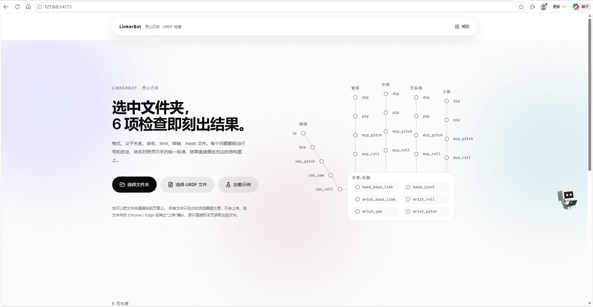
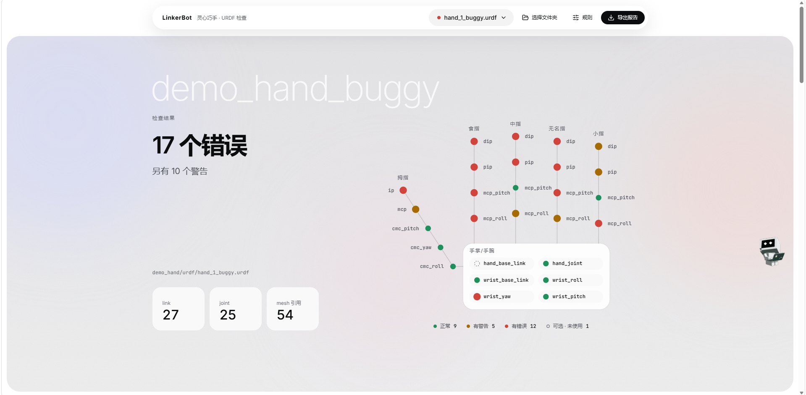
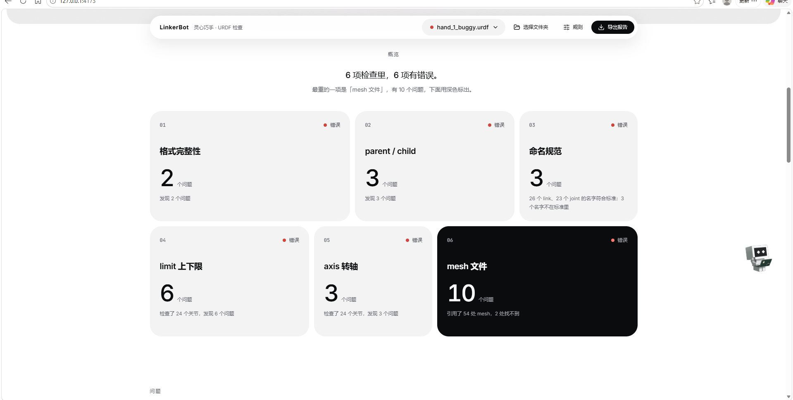
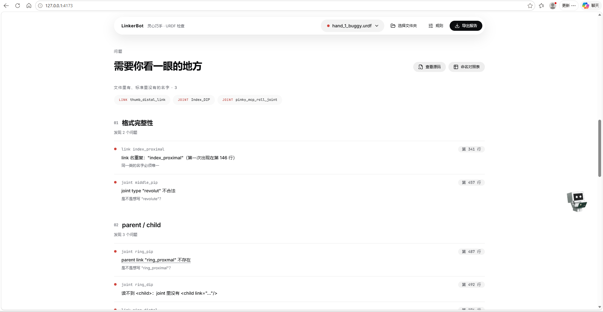
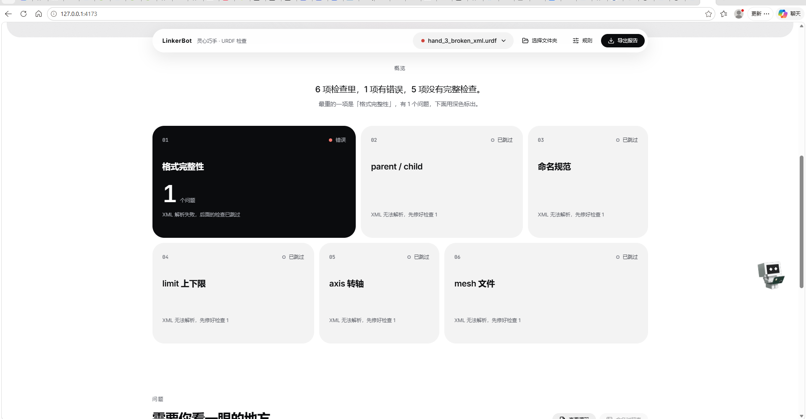

# URDF Checker Webber

[](https://react.dev/)
[](https://www.typescriptlang.org/)
[](https://vitejs.dev/)
[](https://vitest.dev/)
[]()
[]()
[](./LICENSE)

A pure-frontend web tool that **runs 6 automated checks on a URDF file in your browser, never uploading anything**. Designed for robotics engineers building dexterous hands — catch naming mismatches, broken parent/child links, missing meshes, and more **before** the simulation explodes.

Builds to a **single self-contained `dist/index.html`** — open it in Chrome or Edge, no install, no server, no accounts.



---

## What It Checks

| # | Check | What It Catches |
|---|-------|----------------|
| 1 | **Syntax Completeness** | Broken XML, missing required fields (`robot` / `link` / `joint`), duplicate names |
| 2 | **Parent / Child Reference** | Links that don't exist, joints that reference each other wrong, whether the tree actually closes |
| 3 | **Naming Convention** | Link and joint names that drift from the unified standard stored in `config.ts` |
| 4 | **Joint Limit Bounds** | `lower` > `upper`, default values never touched, sign violations (rules configurable) |
| 5 | **Joint Axis** | Missing axis, zero vectors, wrong direction (rules configurable) |
| 6 | **Mesh Files** | `visual` / `collision` references that point to files not found in your meshes folder |

Checks run in order — if #1 fails, #2–6 auto-skip with a clear reason. Any check that itself crashes shows an `error` flag with the message **"This is a bug in the tool — send this URDF to the developer"** so you know it's not your file.

---

## Features

**Big verdict + visual hand map** — instant overview of how bad it is and where:



**6-item check grid** — every check at a glance, darkest block = heaviest problem:



**Issue list grouped by check** — click any item, right-side drawer slides in with the offending XML line highlighted:



**Graceful degradation** — when XML itself breaks, #2–6 clearly show "skipped" with the reason (fix #1 first):



- **Zero backend, zero upload** — all parsing, analysis, and rendering happens in your browser with `saxes`. Your URDF and meshes never leave your machine.
- **Single-file deliverable** — `npm run build` bundles everything (fonts, icons, CSS, JS) into one `dist/index.html`. Share it on WeChat, Slack, or email. Double-click to open.
- **Visual hand map** — your dexterous hand drawn from link positions. Green = ok, yellow = warning, red = error, dashed red circle = missing node. Hover for a tooltip, click to filter.
- **Jump-to-source drawer** — click any issue, a right-side panel slides in with syntax-highlighted XML, the problem line marked red/yellow, and auto-scrolled into view. Press `Esc` to close.
- **Markdown report export** — one click downloads `urdf-check-report.md` with overview table, per-file breakdowns, severity badges, line numbers, and fix hints.
- **27 unit tests** covering all 6 checks, XML parsing, line numbers, file reading, hand layout, and issue filtering.

---

## Quick Start

### Prerequisites
- Node.js 18+
- npm (`.npmrc` already enables `legacy-peer-deps` — don't remove it)

### Install & Run

```bash
npm install
npm run dev        # local dev server at http://localhost:5173
npm run preview    # preview production build (folder drag-drop works here)
npm run build      # type-check + bundle → dist/index.html
npm test           # run unit tests with Vitest
```

### Usage

1. Open the app (either `npm run preview` for drag-drop support, or double-click `dist/index.html` for file-picker-only).
2. Click **Select Folder** and pick the directory containing your `.urdf` files (include the `meshes/` folder for check #6).
3. Results appear instantly — errors on top, warnings below, the visual hand map, and issue list.
4. Click any issue → the drawer opens on the right with the offending line highlighted.
5. Click **Rules** in the top bar to customize the naming convention, limit sign rules, and axis direction rules.
6. Click **Export Report** to download a Markdown summary.

> **Note on `file://` protocol:** when you double-click `dist/index.html`, your browser blocks drag-drop of folders for security. Clicking the **Select Folder** button still works. Drag-drop is only available when served over HTTP (i.e. via `npm run preview`).

---

## Project Structure

```
src/
├── core/                 # Pure functions. No browser dependency. Run in Node too.
│   ├── checks/           # The 6 check implementations (syntax, reference, naming, limit, axis, mesh)
│   ├── config.ts         # Default config (naming convention entries, sign rules, axis rules)
│   ├── urdf.ts           # Builds a typed model from parsed XML
│   ├── xml.ts            # XML parsing + text normalization + line number mapping
│   ├── run.ts            # Orchestrates all checks in order
│   ├── summary.ts        # Aggregate verdict, headline, per-check score
│   ├── handLayout.ts     # Pure-function layout for the visual hand map
│   ├── types.ts          # CheckId, CheckResult, Issue, Status enums
│   └── ...
├── components/           # React UI components
│   ├── Header.tsx        # Top bar (file picker, rules, export)
│   ├── Stage.tsx         # Hero stage with the big verdict number
│   ├── HandMap.tsx       # Visual hand map
│   ├── Bento.tsx         # The 6-check bento grid
│   ├── IssueList.tsx     # Scrollable list of issues
│   ├── SourceView.tsx    # Right-side drawer: highlighted XML + naming table
│   ├── ConfigDialog.tsx  # Rules dialog
│   └── ...
├── io/                   # File reading + download (browser-only)
├── samples/demo.ts       # Sample data for the "Load Demo" button
├── main.tsx              # Vite entry
└── styles.css            # Design tokens (spacing, radius, typography, state colors)
```

`tests/` mirrors `src/core/` — unit tests for every check, XML parsing, file reading, hand layout, and issue filtering.

---

## Design System

All styling uses centralized CSS variables in `src/styles.css` so components never hardcode pixels or hex values.

| Token | Values |
|-------|--------|
| **Spacing** | `8 / 16 / 24 / 40 / 64 / 120 / 160` (`--s1`…`--s7`). Block-to-block gap is fixed at `120px` for heavy whitespace. |
| **Font sizes** | `12 / 14 / 20 / 32 / 56` |
| **Radii** | `8 / 12 / 16 / 24` |
| **State colors** | Only on status dots and labels — never large color blocks. WCAG 4.5:1 contrast ratio. |
| **Glass effect** | Only on floating elements (top bar, dropdowns, drawer, dialogs, hover cards). Automatically falls back to nearly-opaque white when `backdrop-filter` isn't supported. |

---

## Roadmap

### v0.1 — ✅ Delivered
- 6 checks, 27 unit tests, single-file build, Markdown report, naming convention editor.

### v0.2 — UI Polish + Engine Extensibility (Pending Approval)
| Priority | Item | Source |
|----------|------|--------|
| P1-UI | Persistent file-status bar in top bar (never disappears) | Product Owner |
| P1-UI | Collapsed statistics cards with "URDF Structure" title | Product Owner |
| P1-UI | Dynamic hand map layout for arbitrary DOF counts | Product Owner |
| P1-UI | Root node simplified to `hand_base_link` only (no wrist) | Product Owner |
| P1-UI | Error count badges per link node + double-click → jump to issues | Product Owner |
| P1-UI | Bento grid → extensible label + dropdown list (supports N checks) | Product Owner |
| P1-UI | Merge regions 2 × 3 into one unified expandable list | Product Owner |
| P1-Engine | Plugin-style check architecture (so symmetry check + future additions need zero framework changes) | Product Owner |
| P1-Engine | Symmetry check plugin (integrates with existing mirror script) | Product Owner |
| P1-Engine | Enable limit sign rules + axis direction rules (currently `partial`) | Blocked on hardware/simulation sign-off |
| P1-Engine | 3D live preview via three.js | Original plan |

### v0.3
- JSON report export (`report.json`) — makes CI integration possible.
- CLI version: `npx urdf-check file.urdf --report json` (core layer is already browser-decoupled).
- Dark theme (all color tokens already centralized).

### v0.4+ (requires backend)
- Team-shared rule configuration (remote fetch / import-export).
- MR / PR bot integration: post report summary as a comment on GitHub Actions runs.

---

## Known Limitations

- `.xacro` (macro-expanded URDF) is not yet supported.
- File drag-drop is blocked by the browser on `file://` protocol (double-clicked HTML). Use the Select Folder button instead, or serve over HTTP with `npm run preview`.
- Only a single URDF can be analyzed per run. Batch analysis planned for v0.3.
- Only a light theme exists today.

---

## License

MIT © LinkerBot / Lingxin Qiaoshou
